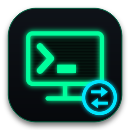

<p align="center">
  
</p>

<h1 align="center">DisplaySwitch</h1>

<p align="center">
  <b>Your monitor layout, as code.</b><br>
  One command to jump between desk setup, single screen, TV and a virtual display for game streaming.
</p>

<p align="center">
  
  
  
  
</p>

```console
$ DisplaySwitch apply stream-phone
Profile 'stream-phone' applied successfully.
```

---

## Why

Windows remembers one layout per set of connected monitors, and switching by hand means
*Settings → Display → Multiple displays → ...* every time. DisplaySwitch turns each layout
into a named **profile** in a YAML file and applies it in one shot: which monitors are on,
resolution, refresh rate, position and primary.

It is a single static `.exe` with no dependencies, no installer, no admin rights and no
background process: call it from a shortcut, a script or any automation tool.

## Highlights

- **Stable IDs.** Monitors are matched by their EDID model code (`DEL41A8`), not by
  `\\.\DISPLAY3` or a port number. Reboots, driver reinstalls and moving cables don't
  break your profiles.
- **Virtual displays.** Wakes up inactive and virtual monitors (e.g. a virtual display
  driver for game streaming), which `ChangeDisplaySettings`-based tools can't do.
- **Never stuck in the dark.** If a profile can't be fully applied, the previous layout is
  restored automatically.
- **Automation-proof.** Retries while Windows blocks display changes (lock screen, UAC
  prompt), runs one switch at a time, logs every result, works from services too.
- **Exit codes.** `0` on success, `1` on failure: easy to chain in scripts.

## Quick start

**1. Download** `DisplaySwitch-<version>-win64.zip` from [Releases](../../releases) and extract it,
e.g. to `C:\Tools\DisplaySwitch`.

**2. Find your monitors:**

```console
$ DisplaySwitch list

Monitors

  ID        Name          State   Mode              Position
  GSM5B7F   LG ULTRAGEAR  ON *    2560x1440 @144Hz  0, 0
  DEL41A8   DELL P2419H   ON      1920x1080 @60Hz   -1920, 360
  SAM0F99   SAMSUNG       OFF     -                 -
  MTT1337   VDD by MTT    OFF     -                 -

  * = primary
```

**3. Describe your layouts** in `profiles.yaml`, next to the exe:

```yaml
profiles:
  desk:
    - id: GSM5B7F
      primary: true
      width: 2560
      height: 1440
      refresh_rate: 144
    - id: DEL41A8
      x: -1920
      y: 360

  gaming:
    - id: GSM5B7F
      primary: true
      refresh_rate: 144
```

**4. Switch:**

```console
$ DisplaySwitch apply gaming
Profile 'gaming' applied successfully.
```

`list` also checks every profile against what is plugged in right now:

```console
Profiles (C:\Tools\DisplaySwitch\profiles.yaml)

  desk          ready             GSM5B7F 2560x1440@144 (primary), DEL41A8   <- current
  gaming        ready             GSM5B7F @144 (primary)
  couch         MISSING SAM0F99   SAM0F99 3840x2160@60 (primary)
```

## Profile recipes

<details open>
<summary><b>Game streaming to a phone or laptop (virtual display)</b></summary>

Turn off the real monitors and stream a virtual display at the client's exact resolution.

```yaml
  stream-phone:
    - id: MTT1337          # virtual display driver
      primary: true
      width: 2400
      height: 1080
      refresh_rate: 120

  stream-laptop:
    - id: MTT1337
      primary: true
      width: 2880
      height: 1800
      refresh_rate: 90
```

The virtual display must offer that resolution: add it to the driver's settings first.
</details>

<details>
<summary><b>Couch mode: TV only, 4K</b></summary>

```yaml
  couch:
    - id: SAM0F99
      primary: true
      width: 3840
      height: 2160
      refresh_rate: 60
```
</details>

<details>
<summary><b>Three monitors side by side</b></summary>

```yaml
  triple:
    - id: GSM5B7F          # center
      primary: true
    - id: DEL41A8          # left
      x: -1920
      y: 0
    - id: DEL41A9          # right
      x: 2560
      y: 0
```
</details>

<details>
<summary><b>Two monitors of the same model</b></summary>

They share the same ID, so add `name:` to tell them apart. If they also share the name,
DisplaySwitch refuses instead of guessing (the choice could swap between runs).

```yaml
    - id: DEL41A8
      name: P2419H
```
</details>

## Profile reference

Each profile lists the monitors that must be **on**. Every monitor not listed is turned **off**.

| Key | Required | Meaning |
|---|---|---|
| `id` | yes\* | Monitor ID from `list` |
| `name` | no | Part of the monitor name, alone or together with `id` |
| `primary` | no | Main monitor, always at `0,0`. Defaults to the first one in the profile |
| `width` `height` | no | Resolution. Omit both to keep the current one |
| `refresh_rate` | no | Hz. Missing or unavailable → the highest rate for that resolution |
| `x` `y` | no | Position of a secondary monitor, relative to the primary's top-left corner |

\* `id` or `name`. A commented template is in [`profiles.example.yaml`](profiles.example.yaml).

## Commands

| Command | Description |
|---|---|
| `DisplaySwitch list` | Connected monitors and a check of every profile |
| `DisplaySwitch apply <profile>` | Switch to a profile |
| `DisplaySwitch version` | Print the version |
| `DisplaySwitch help` | Print the usage |

Every `apply` is logged to `DisplaySwitch.log` next to the exe (rotated at 1 MB).

## How it works

```
  enumerate        QueryDisplayConfig   one entry per connected monitor, ID from the device path
      │
  save layout      QueryDisplayConfig   snapshot of what is on now (for rollback)
      │
  topology         SetDisplayConfig     exactly the profile's monitors on, all others off
      │
  wait             poll until every monitor is really active (slow panels take seconds)
      │
  modes            ChangeDisplaySettingsEx   resolution, refresh, position, primary — one commit
      │
  failed? ──────── SetDisplayConfig     restore the saved layout
```

## Troubleshooting

| Log message | Fix |
|---|---|
| `Monitor X not found or not connected` | Unplugged, off at the wall, or wrong ID: run `list` |
| `Monitor X is ambiguous` | Two monitors share that ID: add `name:` |
| `Resolution WxH not supported by X` | The monitor doesn't offer that mode. Virtual display: add it to the driver settings and restart the driver |
| `SetDisplayConfig kept failing with access denied` | The screen stayed locked (or a UAC prompt stayed open) for more than 10 s |

## Build from source

Needs [MinGW-w64](https://winlibs.com/) with `g++` and `windres` in `PATH`
(`winget install BrechtSanders.WinLibs.POSIX.UCRT`).

```bat
build.bat            :: DisplaySwitch.exe
build.bat release    :: + dist\DisplaySwitch-<version>-win64.zip
```

- Version: [`src/version.h`](src/version.h)
- Icon: [`tools/make_icon.py`](tools/make_icon.py) (Python + Pillow) → `assets/`
- CI: every push is built by GitHub Actions; a `v*` tag publishes a release.

## License

[MIT](LICENSE)
